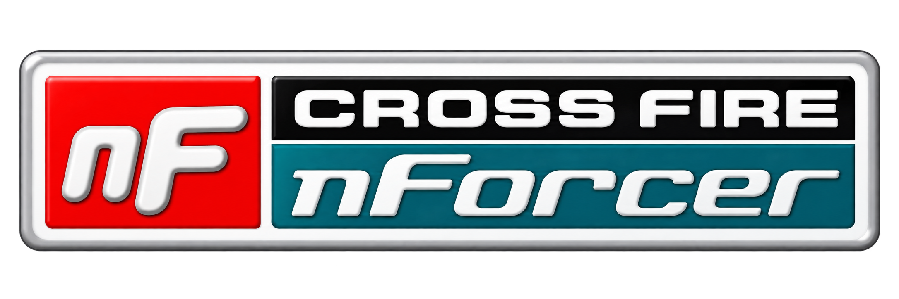

# Crossfire nForcer 0.2.1

Crossfire nForcer patches the chipset-vendor check in supported ATI `ati2mtag.sys` drivers so Crossfire is no longer limited to AMD chipsets. It is a console application for Windows XP 32-bit and .NET Framework 2.0.

## Requirements

- Windows XP 32-bit SP2 or SP3
- .NET Framework 2.0
- Administrator account
- Safe Mode for patching and restoration
- NTFS system volume
- Supported ATI driver installed

## Operation

1. Boot Windows into Safe Mode using F8.
2. Log in as an administrator.
3. Double-click `Crossfire-nForcer.exe`.
4. Enter a menu number and press Enter.

Starting the program does not modify the driver. Select `2` to apply the patch. Results and errors remain visible until Enter is pressed. The program then returns to the menu.

After a successful patch or restoration, exit the program and restart Windows normally. Restart is manual.

## Patch and backup

Target: `%SystemRoot%\System32\drivers\ati2mtag.sys`

Backup: `%SystemRoot%\System32\drivers\ati2mtag.sys.cfpatch.original`

The program checks the PE format, complete instruction pattern and function references before patching. Only the specified instructions and PE checksum are changed. The patch bypasses the entire chipset-vendor gate, including unknown vendors. GPU compatibility checks, Intel-specific settings and CrossFire partner discovery remain unchanged.

Before replacement, the program writes and verifies the original backup and a staged output file. `File.Replace` replaces the driver and retains the previous file. SHA-256 checks verify the installed output and previous-file copy. Logs and replacement artifacts are stored beside the driver:

| File suffix | Content |
|---|---|
| `.cfpatch.original` | Original driver used for restoration |
| `.cfpatch-previous-<id>` | File replaced by an operation |
| `.cfpatch-stage-<id>` | Staged output; normally consumed by replacement |
| `.cfpatch-<id>.log` | Operation, paths, hashes and verification status |

Restoration requires the installed driver to match the patched output generated from the backup. A different driver build is rejected. If the original is already installed, no replacement takes place.

After a driver update, a backup from the previous build may remain. Archive that backup separately before patching the new build. A mismatched backup is not overwritten.

## Rejection conditions

In-place patching and restoration require XP 32-bit, Safe Mode, administrator rights, an NTFS system volume, and a stopped `ati2mtag` service registered to the target file. Protected files, reparse paths, unknown or ambiguous builds, and incompatible backups are rejected. Applying to an already-patched file is also rejected.

Windows File Protection settings are not changed. On replacement failure, the error lists the backup, staged file, previous-file copy and log. Check the recorded file state before restarting. Backups and diagnostic files remain available after an aborted operation.

## Driver coverage

The supplied XP x86 builds validated against the patch rules are:

5.12, 5.13, 6.6, 6.7, 6.12, 7.1, 7.2, 7.3, 7.5, 7.6, 7.7, 7.8, 7.11, 7.12, 8.6, 8.9, 8.12, 9.1, 9.3, 9.4, 9.12, 10.2 Legacy and 14.4.

Recognition is based on the binary, not the Catalyst version string. XP x64 and WDDM drivers are unsupported. The patch does not add support for GPU combinations absent from the driver.

The [hardware test matrix](HARDWARE_TESTING.md) lists known packages, OS variants and hardware-test status. [Driver metadata](archive-reference-drivers.json) contains file versions, hashes and the earliest observed layout families. Record the nForcer version with each hardware test.

## Command-line interface

The menu is the default. Arguments remain available for scripted use:

| Command | Operation |
|---|---|
| No arguments or `/menu` | Open the menu |
| `/check` | Inspect the installed driver; no writes |
| `/check <file>` | Inspect a specified file; no writes |
| `/apply` | Patch the installed driver |
| `/restore` | Restore the original driver |
| `/patch-file <input> <output>` | Create a patched copy; output must not exist |
| `/version` | Print version information |
| `/help` | Print command-line syntax |

Paths containing spaces must be quoted. Direct commands return exit code `0` on success and `1` on error. The interactive menu remains open after operation errors; exiting the menu returns `0`.

## Build and tests

Run `build.cmd` with the .NET Framework 2.0 C# compiler installed. The build targets x86 and the console subsystem. Patch patterns are embedded in the EXE. No configuration file or additional assembly is required beyond .NET Framework 2.0.

Automated validation covers 52 supplied driver modules: 23 accepted XP x86 files and 29 rejected WDDM/x64 files. Accepted outputs match Python patcher 0.3.2 byte-for-byte and pass Windows checksum verification. Tests also cover 12 synthetic layouts, rejection cases, temporary-file backup/restore transactions, environment checks and menu input handling. Results are recorded in `tests/validation-results.json`.

The tests do not modify an installed host driver. The project owner reported successful XP hardware tests with Catalyst 6.7 and 8.12 on 2026-10-11. Other driver builds and the Omega repack remain untested on hardware.

Developer test sources are in `tests`. Compile `TransactionTests.cs` with the three files in `src` and `/main:TransactionTests` to build the temporary-file test harness. Run `validate_console.py --help` for the required fixture paths. Driver binaries are not distributed.

API references: [Safe Mode detection](https://learn.microsoft.com/windows/win32/api/winuser/nf-winuser-getsystemmetrics), [service status](https://learn.microsoft.com/windows/win32/api/winsvc/ns-winsvc-service_status), [file protection](https://learn.microsoft.com/windows/win32/api/sfc/nf-sfc-sfcisfileprotected), [file replacement](https://learn.microsoft.com/windows/win32/api/winbase/nf-winbase-replacefilea).

## License

GPL-3.0-only. See `LICENSE`. Source for the executable is included in `src`. ATI/AMD driver binaries are not included or relicensed.
